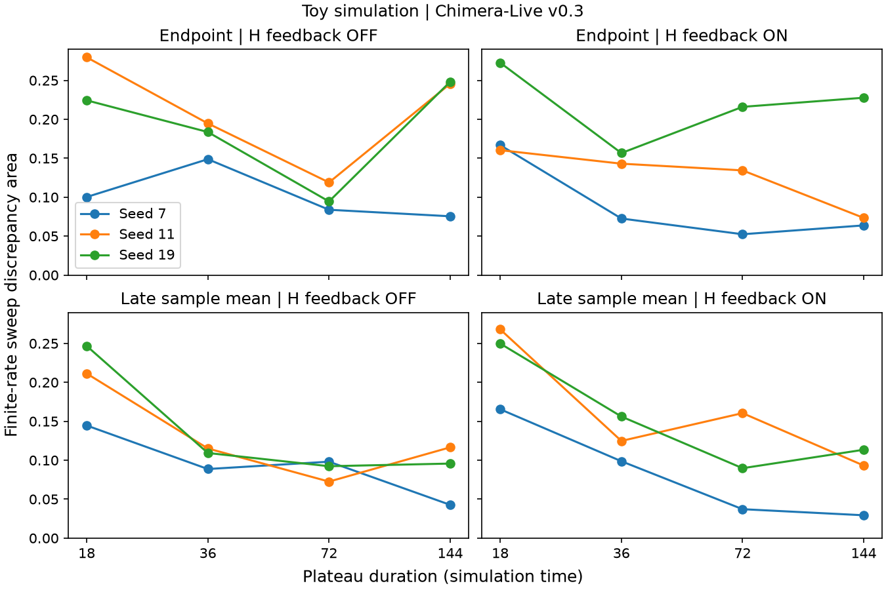

# From Cooperation to Collective Misalignment

Exploratory research by Hashirigaki, Independent Researcher, Hashirigaki Lab.

This collection contains archived outputs and code for two separate numerical studies. The motivating question is whether repeated cooperation can preserve a shared error after reliable corrective evidence arrives. Extension to language-model agents remains a hypothesis.

## Archived measurements

The oscillator study used three seeds, feedback ON/OFF and plateau durations 18, 36, 72 and 144. Late-window discrepancy decreased between durations 18 and 144 in all six matched seed/feedback pairs. Aggregate means changed from 0.2009 to 0.0850 for feedback OFF and 0.2278 to 0.0786 for feedback ON. Intermediate durations and endpoint measures can reverse. Changing feedback also changes effective coupling.

The programmed surrogate used 1,000 matched trials, nine agents and 16 rounds, with correction beginning in round 7. Post-correction wrong-consensus rates were A 0%, B 0.14%, C 10.0% and D 0.69%. C adds historical peer citations to B. D deduplicates sources across current broadcasts and history. Reported paired differences were C minus B +9.9 percentage points (95% interval +8.0 to +11.7) and D minus C -9.3 points (-11.1 to -7.5).

## Interpretation

Measured outcomes concern finite-rate oscillator sweeps and a fixed programmed voting rule. History-dependent persistence of collective objective errors in LLM networks is a proposed research direction. Genuine hysteresis, stable alternative basins, chimera states, chaos, and beneficial early cooperation followed by objective drift in a controlled LLM system remain unverified. Oscillator synchrony and surrogate correctness have separate definitions.

## Inspect the artifacts

- [Results and data definitions](results/README.md)
- [Oscillator package](toy_oscillator/README.md)
- [Programmed surrogate package](synthetic_agent/README.md)
- [Reproduction procedures](docs/REPRODUCIBILITY.md)
- [Provenance](docs/PROVENANCE.md)
- [Verification scope](docs/VERIFICATION.md)
- [Paper submission record](paper/README.md)

The current publication derivative has undergone static inspection only. Archived outputs retain their original bytes. The edited surrogate script has not been executed. A license has not been selected.
