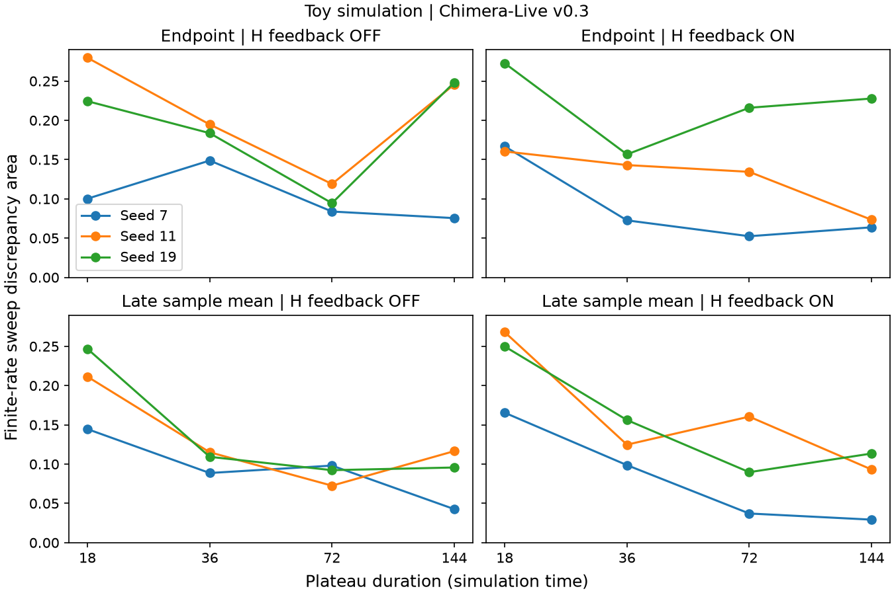

# From Cooperation to Collective Misalignment

Exploratory research by Hashirigaki, Independent Researcher, Hashirigaki Lab.

## Research Overview

This research investigates how collective states emerge, persist, and change through interactions among agents, with particular attention to the effects of shared information, accumulated history, and network structure.

The broader research framework, **Heterogeneous Agent Collective Dynamics (HACD)**, examines the nonlinear collective dynamics of heterogeneous agents with differing objectives, memory states, and interaction histories. It considers how coupling, synchronization, state-space geometry, and external perturbations influence collective behavior and transitions between states.

Synchronization and collective agreement are treated as dynamical properties rather than evidence of correctness. Whether a collective state represents successful coordination or a failure depends on the objectives and context in which it is evaluated.

The preliminary study presented in this repository focuses on a specific question: whether repeated cooperation and evidence reuse can sustain incorrect collective judgments even after verified corrective information becomes available.

Two complementary experiments investigate this question: a three-group inertial-oscillator simulation and a separate programmed-agent experiment involving 1,000 matched trials. These experiments provide initial observations of finite-time collective dynamics and error persistence under specified rules. Further validation is required to establish hysteresis, multistability, chimera states, or corresponding phenomena in language-model agents.

## Research Framework and Publication

**Research framework:** Heterogeneous Agent Collective Dynamics (HACD)

**Submitted paper:** *From Cooperation to Collective Misalignment*

**Subtitle:** *History-Dependent Critical Transitions in Multi-Agent Networks: A Chimera-Inspired Dynamical Systems Approach*

**Venue:** Apart Research — Swarm Alignment Hackathon 2026, Track 2: The Science of Agent Networks

The submitted paper presents an initial investigation within the broader HACD research framework, focusing on history-dependent collective behavior, evidence reuse, correction response, and the conditions under which collective errors may persist.

*Implementation note: Chimera-Live v0.3 is the internal working name used for the preliminary implementation. This name is retained in the original source code and submitted paper for traceability.*

---

## Archived Measurements

The oscillator study used three seeds, feedback ON/OFF and plateau durations 18, 36, 72 and 144. Late-window discrepancy decreased between durations 18 and 144 in all six matched seed/feedback pairs. Aggregate means changed from 0.2009 to 0.0850 for feedback OFF and 0.2278 to 0.0786 for feedback ON. Intermediate durations and endpoint measures can reverse. Changing feedback also changes effective coupling.

The programmed surrogate used 1,000 matched trials, nine agents and 16 rounds, with correction beginning in round 7. Post-correction wrong-consensus rates were A 0%, B 0.14%, C 10.0% and D 0.69%. C adds historical peer citations to B. D deduplicates sources across current broadcasts and history. Reported paired differences were C minus B +9.9 percentage points (95% interval +8.0 to +11.7) and D minus C -9.3 points (-11.1 to -7.5).

## Interpretation

Measured outcomes concern finite-rate oscillator sweeps and a fixed programmed voting rule. History-dependent persistence of collective objective errors in LLM networks is a proposed research direction. Genuine hysteresis, stable alternative basins, chimera states, chaos, and beneficial early cooperation followed by objective drift in a controlled LLM system remain unverified. Oscillator synchrony and surrogate correctness have separate definitions.

## Inspect the artifacts

- [Results and data definitions](results/README.md)
- [Oscillator package](toy_oscillator/README.md)
- [Programmed surrogate package](synthetic_agent/README.md)
- [Reproduction procedures](docs/REPRODUCIBILITY.md)
- [Provenance](docs/PROVENANCE.md)
- [Verification scope](docs/VERIFICATION.md)
- [Paper submission record](paper/README.md)

The current publication derivative has undergone static inspection only. Archived outputs retain their original bytes. The edited surrogate script has not been executed. License terms are provided below.

## License and attribution

Copyright (c) 2026 Hashirigaki.

Different licenses apply to different parts of this repository:

- **MIT License**: Python source code (`*.py`) and dependency specifications (`requirements.txt`). See [LICENSE](LICENSE).
- **CC BY 4.0**: Research documentation (`*.md`), figures (`*.png`), datasets (`*.csv`, `*.jsonl`), and metadata (`*.json`). See [LICENSE-CONTENT.md](LICENSE-CONTENT.md).

The MIT License is not intended to override the CC BY 4.0 terms for research content.

Suggested citation: Hashirigaki (2026), *From Cooperation to Collective Misalignment*, Hashirigaki Lab, https://github.com/Hashirigaki/collective-misalignment-dynamics.

Licenses do not imply that the exploratory findings have been independently validated.
